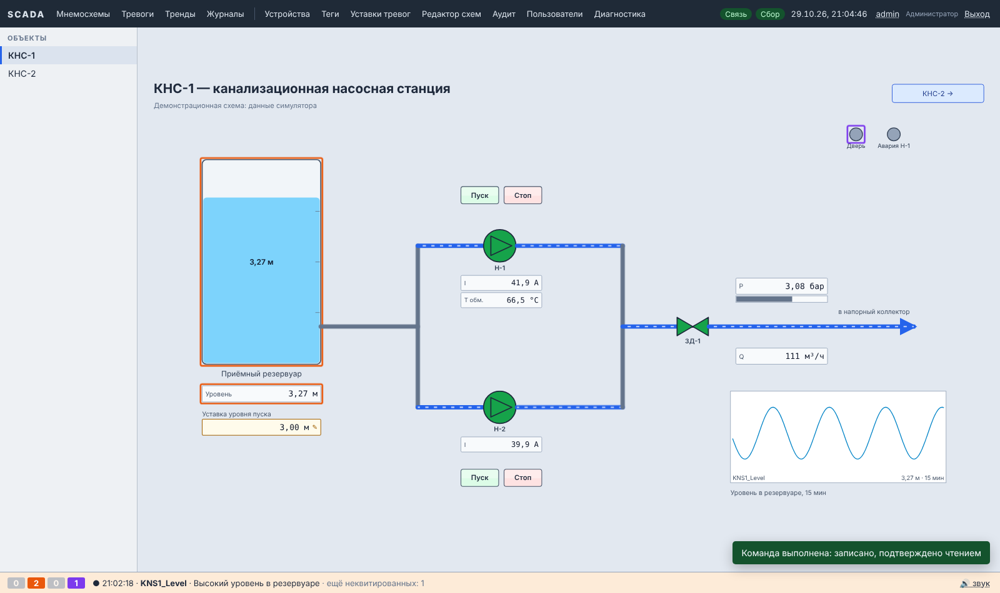

# SCADA MVP

Диспетчерская система верхнего уровня для объектов до ~5 000 тегов на одном Linux-сервере.
Веб-интерфейс оператора и инженера, редактор мнемосхем, тревоги, архив и тренды, команды управления с аудитом.

| Слой | Решение |
|---|---|
| Платформа | .NET 10 LTS, C# |
| Процессы | **служба сбора** (`scada-acquisition`) и **веб-приложение** (`scada-web`) — отдельно |
| Межпроцессный обмен | **PostgreSQL LISTEN/NOTIFY** + таблицы как источник истины |
| БД | PostgreSQL 14+ (секционирование архива средствами PostgreSQL, TimescaleDB не требуется) |
| Протоколы | Modbus TCP (собственный клиент, без зависимостей), OPC UA (стек OPC Foundation), симулятор |
| Фронтенд | React 19 + TypeScript, Vite, SignalR, Zustand, ECharts; мнемосхемы — SVG |
| Развёртывание | Linux + systemd (основной вариант), Docker Compose — опция |



Ещё: [редактор мнемосхем](docs/editor.png) · [тренды](docs/trends.png) · [тревоги](docs/alarms.png) (демо-данные).

---

## 1. Архитектура

```
 ПЛК / приборы / шлюзы
        │ Modbus TCP, OPC UA
        ▼
┌──────────────────────── scada-acquisition (служба сбора) ─────────────────────────┐
│ DeviceWorker ×N  →  TagEngine  →  ValuePublisher ──► tag_current + NOTIFY values    │
│ (опрос, backoff,     (масштаб,     HistorianWriter ─► tag_history (COPY) / диск-буфер│
│  запись команд)       качество,    AlarmService ───► alarm_active, alarm_events      │
│                       deadband)    CommandExecutor ◄── NOTIFY command (+ скан таблицы)│
└──────────────────────────────────────────┬─────────────────────────────────────────┘
                                           │ PostgreSQL: таблицы + LISTEN/NOTIFY
┌──────────────────────── scada-web (веб-приложение) ─────────┴──────────────────────┐
│ REST API (/api) · аутентификация (cookie) · аудит · RealtimeService (LISTEN → кэш) │
│ SignalR /hubs/realtime: клиент подписан только на теги открытого экрана, пачки 250 мс│
└──────────────────────────────────────────┬─────────────────────────────────────────┘
                                           ▼
                         Браузер: АРМ оператора / инженера (React)
```

**Почему два процесса.** Перезапуск или сбой веб-приложения не останавливает опрос оборудования, архив и тревоги.
Служба сбора работает с приоритетом `Nice=-5`.

**Почему LISTEN/NOTIFY.** Не нужен отдельный брокер (Redis/NATS): PostgreSQL уже есть. NOTIFY — это сигнал,
а источник истины — таблицы, поэтому потеря уведомления при разрыве связи не теряет данные:

| Канал | Отправитель | Получатель | Нагрузка |
|---|---|---|---|
| `scada_values` | служба сбора | веб | `{"v":[[tagId,num,str,quality,tsMs],…]}`, пачки ≤ 7,5 КБ |
| `scada_alarm` | триггер `alarm_active` | веб | `{"id","active","acked"}` |
| `scada_alarm_ack` | веб | служба сбора | квитирование / снятие с контроля |
| `scada_command` | триггер `commands` | служба сбора | id команды |
| `scada_command_done` | триггер `commands` | веб | `{"id","status","result"}` |
| `scada_config` | триггеры `devices/tags/alarm_defs` | оба | имя таблицы |
| `scada_device` | триггер `device_status` | веб | id устройства |
| `scada_heartbeat` | служба сбора | веб | признак жизни, раз в 5 с |

Восстановление после разрыва: веб перечитывает `tag_current` и `alarm_active`; служба сбора забирает
`pending`-команды из таблицы и исполняет **только не истёкшие**.

### Безопасность команд управления

1. Проверка роли (оператор и выше), тега (`writable`), диапазона (`write_min/max`), подтверждения оператора.
2. Веб пишет команду в `commands` со сроком жизни (`Commands__TtlSeconds`, по умолчанию 15 с).
3. Служба сбора атомарно захватывает её (`pending → executing`); истёкшая команда помечается `expired` и **не исполняется никогда**.
4. Запись — в очереди устройства между циклами опроса; **автоматических повторов нет**.
5. Контрольное чтение, результат в `commands`, запись в аудите.
6. После перезапуска службы сбора незавершённые команды закрываются (`failed`/`expired`), не повторяются.

SCADA не выполняет функции ПАЗ и регулирования — блокировки и защиты остаются в ПЛК.

### Качество и время

* Коды качества — по образцу OPC UA (Good / Uncertain / Bad с подкодами: нет связи, устарело, вне диапазона…).
* Отсутствующее значение — `null`, а не ноль. На экране последнее известное значение показывается штриховкой.
* Все метки времени в UTC: время источника и время сервера.
* Три независимые зоны нечувствительности: экран, архив, (тревоги используют гистерезис).

### Тревоги (по мотивам ISA-18.2)

«Активна» и «квитирована» — независимые признаки; задержка срабатывания, гистерезис, 4 приоритета,
снятие с контроля с обязательной причиной, журнал всех переходов. Состояние персистентно (`alarm_active`) —
тревоги переживают перезапуск и готовы к будущему резервированию.

### Архив

* Запись по изменению (с зоной нечувствительности и принудительным интервалом) или по интервалу.
* Пакетная вставка бинарным `COPY`, до 5 000 строк за раз.
* Месячные секции `tag_history_YYYYMM`; создание наперёд и удаление старше `HistoryRetentionDays` — автоматически.
* БД недоступна → пачки пишутся в дисковый буфер (`/var/lib/scada/spool`, лимит `SpoolMaxMb`) и досылаются после восстановления.
* Тренды: до 1 с на точку — исходные значения, иначе агрегаты avg/min/max (`date_bin`).

### Аудит

`audit_log` — только добавление: триггеры запрещают UPDATE/DELETE/TRUNCATE, каждая запись содержит
SHA-256 цепочки. Проверка целостности — кнопка в разделе «Аудит» (функция `audit_verify()`).
Пишутся: входы (в т.ч. неудачные), изменения конфигурации, команды, квитирование, импорт/экспорт, пользователи.

### Черновик → проверки → публикация → откат

Подробно модель описана в документе для команды «SCADA: модель прав и публикация конфигурации». В коде реализованы этапы 1–2:

* **Черновик** — рабочие таблицы `devices`, `tags`, `alarm_defs`, `mnemos`. Правки инженеров видны всем инженерам сразу,
  но **служба сбора и операторы их не видят**. Удаление мягкое (`deleted = true`), чтобы версии можно было откатить.
  Одновременная правка одного объекта — `row_version`, второй получит 409. Кто что менял — `draft_changes`.
* **Опубликованная конфигурация** — неизменяемые снимки JSON в `config_versions` (триггер запрещает менять и удалять).
  Служба сбора читает только последний снимок, после применения отмечает `applied_at`/`applied_ms` и шлёт `scada_config_applied`.
  Операторы видят опубликованные версии мнемосхем; редактор работает с черновиком (`?draft=1`).
* **Публикация** (`POST /api/publish`): список изменений с авторами, проверки `ConfigValidator`, причина, повторный ввод пароля.
  Ошибки блокируют (422), предупреждения требуют подтверждения (428), устаревшая базовая версия — 409.
  Глобальная блокировка `pg_advisory_xact_lock` — два инженера не опубликуют одновременно. Опция «четыре глаза»: `Publishing:FourEyes`.
* **Откат** (`POST /api/versions/{n}/rollback`) — содержимое версии N публикуется как новая версия; история не переписывается.
  **Сброс черновика** (`POST /api/draft/discard`) — черновик возвращается к работающей версии.
* Проверки: несуществующее устройство/тег, неверный адрес, неполный масштаб, пересечение адресов Modbus (с записываемым тегом —
  ошибка), запись без диапазона, новый записываемый тег, снятое подтверждение команды, тревоги без уставки/текста/вне шкалы,
  порядок уставок HiHi > Hi > Lo > LoLo, схема со ссылкой на несуществующий тег, оценка нагрузки на архив.
  «Технические» предупреждения по устройствам — только для новых и изменённых, чтобы не повторяться в каждой публикации.
* Интерфейс: плашка «Черновик: N изменений · в работе в.N» в шапке, раздел «Публикация» (изменения по объектам с «было → стало»,
  подсветка влияющих на управление, проверки, форма публикации, ожидание подтверждения службы сбора), «История версий» с откатом.

---

## 2. Состав

```
backend/
  src/Scada.Core            модель, качество, обработка значений, движок тревог, LISTEN/NOTIFY, доступ к БД
  src/Scada.Drivers         контракт драйвера, Modbus TCP, симулятор
  src/Scada.Drivers.OpcUa   драйвер OPC UA (отдельная сборка — см. «Лицензии»)
  src/Scada.Acquisition     служба сбора (Worker Service, systemd notify)
  src/Scada.Web             REST API, SignalR, аутентификация; раздаёт собранный фронтенд из wwwroot
  tests/Scada.Tests         модульные и интеграционные тесты (тревоги, обработка, Modbus с тестовым сервером)
frontend/                   React + TypeScript
  src/mnemo                 модель мнемосхемы, элементы, исполнение, редактор
  src/pages                 экраны оператора и инженера
db/
  001_schema.sql            схема (идемпотентна)
  002_demo.sql              демо: КНС-1 на симуляторе + КНС-2 с недоступным ПЛК
  003_app_role.sql          роль scada_app с минимальными правами
  004_publication.sql       версии конфигурации, черновик, мягкое удаление, журнал правок
deploy/                     build.sh, install.sh, systemd-юниты, пример scada.env
Dockerfile, docker-compose*.yml   опциональный запуск в контейнерах
```

### Функции интерфейса

* **АРМ оператора:** дерево объектов, мнемосхемы в реальном времени, панели управления оборудованием (пуск/стоп,
  открыть/закрыть), уставки, кнопки, строка тревог со звуком, тревоги (квитирование, снятие с контроля, журнал),
  тренды (до 8 тегов, оси по единицам, онлайн-режим, экспорт CSV), журнал команд, диагностика.
* **АРМ инженера:** устройства, теги (поиск, живые значения, импорт/экспорт CSV), уставки тревог,
  **редактор мнемосхем**, **публикация и история версий конфигурации**, журнал аудита.
* **Администратор:** пользователи и роли.

### Редактор мнемосхем

15 элементов: прямоугольник, эллипс, трубопровод (анимация потока), надпись, значение, лампа, кнопка, уставка,
ёмкость, шкала, насос, двигатель, задвижка, переход на схему, мини-тренд. Любой элемент можно скрывать по тегу.

Перетаскивание из палитры, выделение рамкой и Shift, перемещение с привязкой к сетке, изменение размера
(Shift — пропорционально), концы трубопроводов, выравнивание и распределение, порядок слоёв, копирование (Ctrl+C/V, Ctrl+D),
отмена/повтор (Ctrl+Z/Y), стрелки, масштаб, живые значения прямо в редакторе, режим просмотра, история версий
с восстановлением, защита от одновременной правки (409 при конфликте версий), экспорт/импорт JSON.

Схема — JSON в `mnemo_versions.doc`, привязки по **имени** тега: схему можно перенести на другой объект с тем же словарём тегов.

### Роли

| Роль | Права |
|---|---|
| Наблюдатель | просмотр |
| Оператор | + команды, квитирование, снятие с контроля |
| Инженер | + конфигурация, мнемосхемы, аудит |
| Администратор | + пользователи, проверка целостности аудита |

Пароли — PBKDF2 (ASP.NET Identity), блокировка на 5 минут после 5 неудачных попыток, смена пароля при первом входе.
Cookie `HttpOnly`, `SameSite=Strict`; изменяющие запросы требуют заголовок `X-Scada-Request` (защита от CSRF); CSP.

---

## 3. Установка (Linux + systemd)

**Требования:** Linux x64 (Ubuntu 22.04+/Debian 12/Astra Linux 1.7+/РЕД ОС 7.3+ — проверить на целевой ОС),
PostgreSQL 14+ (или Postgres Pro). .NET на сервере не нужен — бинарники самодостаточные.

На машине сборки (нужны .NET SDK 10 и Node.js 20+):

```bash
./deploy/build.sh                       # → dist/scada-mvp-0.1.0-linux-x64.tar.gz
SCADA_OPCUA=false ./deploy/build.sh     # сборка без драйвера OPC UA
```

На сервере:

```bash
tar xzf scada-mvp-0.1.0-linux-x64.tar.gz && cd scada-mvp-0.1.0-linux-x64
sudo SCADA_DEMO=1 ./deploy/install.sh   # SCADA_DEMO=1 — с демо-схемой КНС
```

Скрипт создаёт пользователя `scada`, БД с владельцем `scada_owner`, роль `scada_app` с минимальными правами,
`/etc/scada/scada.env` со случайными паролями (начальный пароль `admin` выводится в консоль) и включает службы.
Повторный запуск обновляет бинарники и схему, данные сохраняются.

```bash
systemctl status scada-acquisition scada-web
journalctl -u scada-acquisition -f
curl http://localhost:8080/health
```

> После каждого применения `001_schema.sql` повторно выполните `003_app_role.sql` (install.sh делает это сам):
> `CREATE OR REPLACE FUNCTION` сбрасывает атрибут `SECURITY DEFINER` функций обслуживания архива.

### Docker (опция)

```bash
docker compose -f docker-compose.yml -f docker-compose.demo.yml up -d --build
# http://localhost:8080, admin / admin12345 (смена при первом входе)
```

Для опроса ПЛК в технологической сети службе сбора часто удобнее `network_mode: host`.

### Прототип для оценки интерфейса (без сервера)

```bash
cd frontend && npm run build:demo     # → dist-demo/scada-prototype.html (один файл)
npm run dev:demo                      # то же с горячей перезагрузкой
```

Бэкенд в этом режиме заменён моделью КНС прямо в браузере (`src/demo/`): приток, два насоса, задвижка,
режим «Автомат», тревоги, команды, архив за 24 ч. Панель прототипа: смена роли, сценарии отказов,
скорость модели и 8 заданий юзабилити-теста с автоматической проверкой и временем выполнения.
В рабочую сборку (`npm run build`) демо-код не попадает.

### Разработка

```bash
# БД
createdb scada && psql -d scada -f db/001_schema.sql -f db/002_demo.sql
# бэкенд (два терминала)
cd backend && dotnet run --project src/Scada.Acquisition
cd backend && dotnet run --project src/Scada.Web          # http://localhost:8080
# фронтенд с горячей перезагрузкой
cd frontend && npm install && npm run dev                 # http://localhost:5173 (прокси на 8080)
# тесты
cd backend && dotnet test
```

Строка подключения по умолчанию: `Host=localhost;Database=scada;Username=scada;Password=scada`
(`appsettings.json` или переменная `ConnectionStrings__Scada`).

---

## 4. Адресация тегов

| Протокол | Адрес | Примеры |
|---|---|---|
| Modbus TCP | `область:смещение[.бит][#регистров][:порядок]`, смещение **с нуля** | `hr:100`, `ir:20:cdab`, `hr:5.3`, `co:0`, `di:7`, `hr:200#10` |
| OPC UA | NodeId | `ns=2;s=Line1.Pump1.Speed`, `ns=3;i=1001` |
| Симулятор | функция | `sine:period=60,amp=10,offset=50`, `ramp:…`, `square:period=10`, `random:min=0,max=1`, `memory:имя=0`, `follow:имя,tau=5` |

Modbus: области `co` (coils), `di`, `ir`, `hr`; порядок байт `ABCD` (по умолчанию), `CDAB`, `BADC`, `DCBA`;
параметры устройства `{"unitId":1,"byteOrder":"ABCD","maxRegisters":100,"maxGap":8}`. Смежные адреса объединяются в групповые запросы.

OPC UA: `{"security":true,"autoAcceptUntrusted":false,"user":"","password":"","pkiPath":"/var/lib/scada/pki"}`.
Сертификат недоверенного сервера попадает в `pki/rejected` — перенесите его в `pki/trusted`.
`autoAcceptUntrusted=true` — только для стенда.

Импорт тегов — CSV с разделителем «;» (формат = файл экспорта), всё-или-ничего с отчётом об ошибках по строкам.

---

## 5. Что проверено и что нет

Среда разработки этого MVP не имела доступа к NuGet, поэтому:

| Проверка | Результат |
|---|---|
| Схема БД, демо-данные, роль приложения — на PostgreSQL 16 | ✅ применяются, идемпотентны; проверены LISTEN/NOTIFY-триггеры, upsert `tag_current`, захват/истечение команд, агрегаты `date_bin`, цепочка и неизменяемость аудита, права `scada_app` |
| Компиляция `Scada.Core`, `Scada.Drivers`, `Scada.Acquisition`, `Scada.Web` | ✅ без ошибок и предупреждений — **против API-заглушки Npgsql** (реальный пакет не был доступен) |
| 46 тестов: тревоги, масштаб/качество/deadband, упаковка NOTIFY, Modbus-кодек, драйвер Modbus против тестового TCP-сервера, проверки и сравнение конфигурации, снимки | ✅ все проходят |
| Фронтенд: `tsc` strict + сборка Vite | ✅ |
| Интерфейс в браузере (Chromium) на макете API: мнемосхема, панель насоса → команда, редактор (перетаскивание, рамка, ресайз, отмена, просмотр), тревоги, тренды | ✅ без ошибок в консоли |
| `004_publication.sql` на PostgreSQL 16: мягкое удаление, `row_version`, неизменяемость `config_versions` | ✅ |
| Публикация в прототипе: правка → ошибка блокирует → предупреждения → публикация → применение → история → откат; конфликт `row_version` | ✅ |
| `Scada.Drivers.OpcUa` | ⚠️ **не компилировался** — нужен пакет OPC Foundation |
| Совместный запуск служб с реальным Npgsql | ⚠️ **не выполнялся** — первый шаг на стенде с доступом к NuGet: `dotnet test` и `docker compose … up` |

---

## 6. Ограничения MVP и следующие шаги

* OPC UA работает опросом (Read). Подписки (MonitoredItems), Browse адресного пространства — следующий шаг.
* Нет резервирования; задел — персистентное состояние тревог и команд, атомарный захват команд.
* Протоколы второй очереди (МЭК 104, СПОДЭС/DLMS, счётчики «Меркурий») — через плагин `IDriverProvider`; лицензии библиотек проверить.
* Расчётные теги, отчёты (в т.ч. энергопотребление), шаблоны оборудования, управление сертификатами OPC UA из интерфейса.
* Этапы 3–5 документа о правах: роли как наборы прав и области действия (объекты), классы критичности команд
  (повторный пароль, два оператора), сопоставление групп AD/LDAP.
* Запись бита в holding-регистр Modbus выполняется чтением-модификацией-записью (неатомарно) — для критичных
  команд используйте отдельный регистр или coil.

### Лицензии зависимостей

| Компонент | Лицензия | Комментарий |
|---|---|---|
| Npgsql | PostgreSQL | без ограничений |
| OPC Foundation UA .NET Standard | RCL (для членов OPC Foundation) / GPL-2.0 | **до коммерческого релиза** — членство в OPC Foundation или коммерческий SDK; драйвер изолирован, сборка без него: `-p:ScadaOpcUa=false` |
| React, Zustand, Vite | MIT | |
| ECharts, @microsoft/signalr | Apache-2.0 | |
| Modbus TCP | собственная реализация | |
